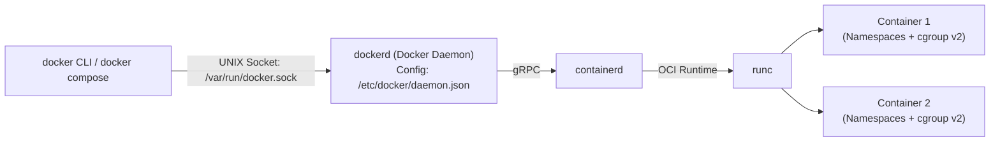

# Docker: Installation and Setup (Rocky Linux 9.x)

| | |
|---|---|
| **Cluster** | 04 Containers & IDP |
| **Role** | Anchor (Container Packaging & Local Runtime) |
| **Category** | Container Engine |
| **Prerequisites** | Linux CLI fundamentals, basic user & group administration, Rocky Linux 9.x system with root or sudo access |
| **Target version** | Docker Engine 27.x+ (Docker CE) on Rocky Linux 9.x (x86_64 / aarch64), containerd 1.7+, Docker Compose v2 |
| **Capstone phase** | Phase 1 (Months 1-4) |
| **Official docs** | https://docs.docker.com/engine/install/centos/ |

> A production-aligned installation and configuration guide for standing up Docker Community Edition (Docker CE) on Rocky Linux 9.x. This guide addresses critical enterprise Linux considerations: resolving conflicting default Red Hat packages (Podman/Buildah), configuring the official Docker repository for Enterprise Linux 9, tuning the Docker daemon (`daemon.json`) for systemd cgroup v2 and log rotation, managing non-root security permissions, handling SELinux volume labelling (`:z`/`:Z`), and verifying with smoke tests.

---

## 1. Architecture and Rocky Linux 9 Considerations

Docker Community Edition (Docker CE) consists of three decoupled layers:
1. **`docker` CLI**: The command-line client communicating via UNIX socket (`/var/run/docker.sock`) or remote TLS.
2. **`dockerd`**: The background daemon managing images, networks, volumes, and API calls.
3. **`containerd` + `runc`**: The underlying OCI container runtime executing syscalls, configuring Linux namespaces, and binding cgroups.



### Key Considerations for Rocky Linux 9.x

- **Upstream RHEL Strategy vs Docker CE**: Red Hat Enterprise Linux (and downstream Rocky Linux) does not ship Docker in its official repositories (`baseos` or `appstream`). Instead, RHEL ships Podman and Buildah. To run Docker CE, you must add the official Docker repository.
- **Package Conflicts**: Installing Docker CE while `podman`, `buildah`, or `podman-docker` packages are installed causes DNF dependency conflicts. Conflicting packages must be removed first.
- **cgroup v2 by Default**: Rocky Linux 9 runs systemd cgroup v2 (`/sys/fs/cgroup`). Modern Docker Engine (v24+) fully supports unified cgroup v2 out of the box.
- **SELinux Enforcing**: Rocky Linux enforces SELinux by default. Container volume mounts touching host storage require appropriate SELinux type contexts or the `:z`/`:Z` mount flags.

---

## 2. Step 1: Remove Conflicting Packages

Rocky Linux 9 installs Podman-related utilities by default in many base profiles. If `podman-docker` or older Docker components exist on the system, package managers will block `docker-ce` installation due to binary file collisions (`/usr/bin/docker`).

Execute on the Rocky Linux host:

```bash
sudo dnf remove -y \
  docker \
  docker-client \
  docker-client-latest \
  docker-common \
  docker-latest \
  docker-latest-logrotate \
  docker-logrotate \
  docker-engine \
  podman \
  podman-docker \
  runc \
  buildah
```

> [!NOTE]
> If none of these packages are currently installed, `dnf` will simply report "No match for argument" and exit cleanly.

---

## 3. Step 2: Set Up the Official Docker Repository

Docker does not maintain a separate repository label for "Rocky Linux", but official Docker CE packages for CentOS/RHEL 9 (`centos/docker-ce.repo`) are 100% binary-compatible with Rocky Linux 9.

Install the `dnf-plugins-core` utility package and register the repository:

```bash
# Install repository management utilities
sudo dnf install -y dnf-plugins-core

# Add the official Docker CE repository for Enterprise Linux 9
sudo dnf config-manager --add-repo https://download.docker.com/linux/centos/docker-ce.repo
```

Verify that the repository is enabled and reachable:

```bash
dnf repolist | grep docker
```

Expected output:
```text
docker-ce-stable    Docker CE Stable - x86_64
```

---

## 4. Step 3: Install Docker Engine and Plugins

Install the complete modern Docker toolset:
- **`docker-ce`**: The Docker Engine daemon.
- **`docker-ce-cli`**: The CLI client.
- **`containerd.io`**: The container execution runtime.
- **`docker-buildx-plugin`**: Next-generation BuildKit integration for multi-platform builds.
- **`docker-compose-plugin`**: Native Docker Compose v2 (`docker compose`).

```bash
sudo dnf install -y \
  docker-ce \
  docker-ce-cli \
  containerd.io \
  docker-buildx-plugin \
  docker-compose-plugin
```

> [!TIP]
> If prompted to import the Docker GPG signing key (`060A 61C5 1B55 8A7F 742B 77AA C52F EB6B 621E 9F35`), enter `y` to accept and verify package authenticity.

---

## 5. Step 4: Configure the Docker Daemon (`daemon.json`)

By default, Docker runs without log rotation limits and without live-restore capabilities. On production servers, unconstrained container stdout/stderr logs can fill the root filesystem, and daemon restarts kill all active containers.

Create `/etc/docker/daemon.json` with production best practices before starting the service:

```bash
sudo mkdir -p /etc/docker

sudo tee /etc/docker/daemon.json <<'EOF'
{
  "log-driver": "json-file",
  "log-opts": {
    "max-size": "50m",
    "max-file": "3"
  },
  "live-restore": true,
  "exec-opts": ["native.cgroupdriver=systemd"],
  "storage-driver": "overlay2"
}
EOF
```

### Why These Settings Matter

| Configuration Option | Purpose | Production Impact |
|---|---|---|
| `"log-driver": "json-file"` + `"max-size": "50m"` | Limits container log files to 50 MB, keeping at most 3 backups. | Prevents runaway application logs from exhausting node disk space and crashing the OS. |
| `"live-restore": true` | Keeps containers running even if the Docker daemon shuts down or is upgraded. | Minimizes downtime during Docker security patches and daemon restarts. |
| `"exec-opts": ["native.cgroupdriver=systemd"]` | Enforces the `systemd` cgroup manager. | Matches Rocky Linux 9's native init system; eliminates dual-manager slice conflicts. |
| `"storage-driver": "overlay2"` | Explicitly enforces the high-performance Linux OverlayFS driver. | Standard Linux copy-on-write storage architecture. |

---

## 6. Step 5: Start and Enable the Docker Service

Enable both `docker` and its underlying `containerd` runtime so they launch automatically across system reboots:

```bash
# Reload systemd configuration
sudo systemctl daemon-reload

# Enable and immediately start Docker and containerd
sudo systemctl enable --now containerd
sudo systemctl enable --now docker
```

Verify service status:

```bash
sudo systemctl status docker --no-pager
```

Ensure the output reports:
`Active: active (running)`

---

## 7. Step 6: Post-Installation (Non-Root User Access)

By default, the Docker daemon binds to a UNIX socket (`/var/run/docker.sock`) owned by user `root` and group `docker`. Running Docker commands as a non-root user without privileges produces:
`permission denied while trying to connect to the Docker daemon socket`.

### 7.1 Add User to the `docker` Group

Add your non-root user (e.g. `rocky`) to the `docker` group:

```bash
# Add current user to docker group
sudo usermod -aG docker $USER

# Activate group changes in current shell session without logging out
newgrp docker
```

> [!WARNING]
> **Security Implication of the `docker` Group**:
> Granting a user access to the `docker` group is functionally equivalent to root privileges. Any member of the group can run `docker run -v /:/host -it alpine chroot /host` to obtain unrestricted root access on the host filesystem. In enterprise environments, grant Docker group membership strictly to trusted administrators.

### 7.2 Alternative: Rootless Docker

If absolute non-root security is required in a multi-tenant environment, install Docker Rootless mode instead of using the shared group:

```bash
# Install rootless prerequisites
sudo dnf install -y shadow-utils-subid docker-ce-rootless-extras

# Run the rootless setup tool as regular user (not root)
dockerd-rootless-setuptool.sh install
```

---

## 8. Rocky Linux Specifics: SELinux and Firewalld

### 8.1 SELinux and Volume Mounts

Rocky Linux 9 defaults to SELinux `Enforcing`. When mounting a host directory into a container, SELinux prevents the container process from reading or writing host files unless the files carry the container SELinux context (`container_file_t`).

When mounting host volumes, append the `:z` or `:Z` flag:

```bash
# Shared volume (accessible by multiple containers):
docker run -d -v /data/app:/app:z my-app:latest

# Private volume (exclusive to this container instance):
docker run -d -v /data/db:/var/lib/postgresql/data:Z postgres:16
```

- `:z` instructs Docker to relabel the host directory so all container contexts can access it.
- `:Z` labels the directory with a unique private MCS category so only *this specific container* can access it.

### 8.2 Firewalld and Port Forwarding

Docker manages host `iptables` rules directly to implement container port forwarding (`-p 8080:80`). On Rocky Linux 9, `firewalld` uses the `nftables` backend.

If you reload `firewalld` (`sudo firewall-cmd --reload`), the Docker iptables chains can be flushed, breaking container network routing.

To ensure resilient networking:
1. Ensure masquerading is enabled in firewalld:
   ```bash
   sudo firewall-cmd --permanent --add-masquerade
   sudo firewall-cmd --reload
   ```
2. If `firewalld` is reloaded while containers are running, restart Docker to restore iptables chains:
   ```bash
   sudo systemctl restart docker
   ```

---

## 9. Verification and End-to-End Smoke Test

Run the verification checklist to confirm the engine, runtime, and plugins are operating correctly:

### 9.1 Check Docker Version and Runtime Architecture

```bash
docker version
```

Verify both **Client** and **Server** sections report matching releases (e.g., `27.x.x`).

Check system internals:

```bash
docker info | grep -E "Storage Driver|Cgroup Driver|Cgroup Version"
```

Expected output:
```text
 Storage Driver: overlay2
 Cgroup Driver: systemd
 Cgroup Version: 2
```

### 9.2 Execute Hello-World Container

Run the official test image to verify image pulling, container creation, cgroup binding, and stdout routing:

```bash
docker run --rm hello-world
```

Output must include:
`Hello from Docker!`
`This message shows that your installation appears to be working correctly.`

### 9.3 Verify Docker Compose and BuildKit

Check native Compose plugin integration:

```bash
docker compose version
```

Expected output:
```text
Docker Compose version v2.x.x
```

Check Buildx plugin integration:

```bash
docker buildx version
```

Expected output:
```text
github.com/docker/buildx v0.x.x
```

---

## 10. Complete Uninstall and Teardown

If you ever need to completely remove Docker, its repositories, and all downloaded images/volumes:

```bash
# 1. Stop services
sudo systemctl stop docker containerd

# 2. Remove Docker packages
sudo dnf remove -y \
  docker-ce \
  docker-ce-cli \
  containerd.io \
  docker-buildx-plugin \
  docker-compose-plugin \
  docker-ce-rootless-extras

# 3. Clean residual storage and configuration (Caution: Destroys all containers & images)
sudo rm -rf /var/lib/docker
sudo rm -rf /var/lib/containerd
sudo rm -rf /etc/docker
sudo rm -f /etc/yum.repos.d/docker-ce.repo

# 4. Clean DNF cache
sudo dnf clean all
```

---

## 11. Troubleshooting Common Rocky Linux 9 Issues

| Symptom | Probable Cause | Diagnostic Command | Immediate Resolution |
|---|---|---|---|
| **`Problem: package podman-docker conflicts with docker-ce`** | Rocky Linux base packages for Podman are installed. | `rpm -qa \| grep podman` | Run `sudo dnf remove -y podman podman-docker buildah runc` and re-run installation. |
| **`permission denied while trying to connect to the Docker daemon socket`** | User is not in the `docker` group or group session is not active. | `groups` or `id` | Run `sudo usermod -aG docker $USER && newgrp docker`. If persistent, log out and log back in. |
| **`Permission denied` inside container on volume mount** | SELinux is blocking container access to host directory. | `getenforce` and `sudo ausearch -m avc -ts recent` | Append `:z` (shared) or `:Z` (private) to the `-v` mount flag, or set `chcon -Rt container_file_t /path/to/host/dir`. |
| **Containers lose network connectivity after `firewall-cmd --reload`** | Firewalld wiped Docker's dynamic iptables/nftables forwarding chains. | `sudo iptables -L -n \| grep DOCKER` | Run `sudo systemctl restart docker` to recreate Docker's firewall chains. |
| **`WARNING: bridge-nf-call-iptables is disabled`** | Kernel bridge netfilter module not loaded. | `sysctl net.bridge.bridge-nf-call-iptables` | Run `sudo modprobe br_netfilter` and set `net.bridge.bridge-nf-call-iptables = 1` in `/etc/sysctl.d/99-docker.conf`. |
| **`failed to start daemon: error initializing graphdriver: overlay2`** | Kernel missing overlay module or incompatible filesystem. | `lsmod \| grep overlay` | Run `sudo modprobe overlay` and ensure the backing filesystem is ext4 or xfs with `d_type=true` (`xfs_info /`). |

