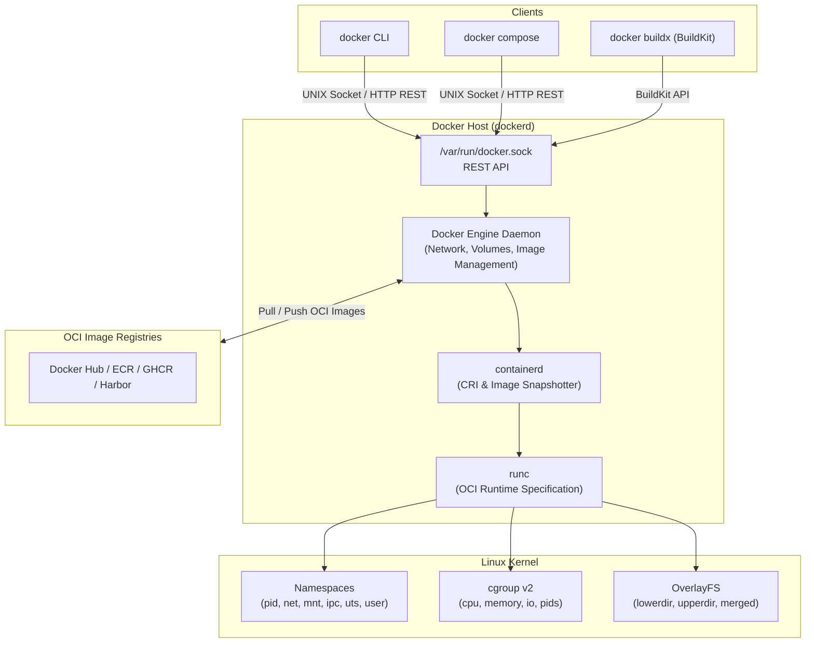

# Docker

| | |
|---|---|
| **Cluster** | 04 Containers & IDP |
| **Role** | Anchor (Container Packaging, OCI Images & Build Engine) |
| **Category** | Container engine and runtime |
| **Prerequisites** | Linux fundamentals (namespaces, cgroups, file permissions, signals, systemd), basic shell scripting |
| **Target version** | Docker Engine 27.x+ (Docker CE), Docker Compose v2, BuildKit |
| **Capstone phase** | Phase 1 (Months 1-4) |
| **Official docs** | https://docs.docker.com/ |

> Docker is the industry-standard containerization engine that packages software and its complete runtime dependencies into immutable, portable Open Container Initiative (OCI) images. After working through this folder you will master container isolation primitives (Linux namespaces, cgroup v2, OverlayFS copy-on-write storage layers), write minimal multi-stage distroless `Dockerfiles`, build multi-architecture binaries with BuildKit (`docker buildx`), manage polyglot local stacks with Docker Compose, harden runtime security (non-root execution, seccomp, capability dropping, rootless mode), and diagnose container crashes using low-level kernel inspections.

---

## Why This Tool Exists

Before Docker popularized Linux containers in 2013, software teams suffered from the classic *"it works on my machine"* dilemma. Applications were either deployed directly onto bare-metal hosts or packaged inside heavy hardware-virtualized virtual machines (VMs):

1. **Bare-metal deployments were fragile**: Different applications on the same host shared system libraries (`libc`, Python/Java runtimes), leading to dependency hell, version collisions, and configuration drift.
2. **Virtual machines were resource-heavy**: A VM emulates entire hardware stacks, including virtual BIOS, virtual disks, and an entire guest operating system. Running ten microservices required booting ten separate OS kernels, each consuming gigabytes of RAM and taking minutes to start.

Docker's key breakthrough was combining existing Linux kernel isolation features—**namespaces** (for process, mount, and network isolation) and **cgroups** (for resource budgeting and limits)—with a union mount filesystem (**OverlayFS**). This allowed processes to run directly on the host kernel in milliseconds while maintaining isolated filesystems and resource boundaries. Docker standardized this packaging into the Open Container Initiative (OCI) image specification, enabling an image built on a developer's workstation to run identically on any Linux server or Kubernetes cluster worldwide.

---

## Architecture

### Components

- **`docker` CLI / Compose / Buildx**: User-facing interfaces that serialize commands into REST API calls directed at the Docker daemon.
- **`dockerd`**: The long-running daemon responsible for receiving API requests, routing network bridges (`docker0`), tracking volume mounts, and caching image layers.
- **`containerd`**: The decoupled, CNCF-graduated container supervisor that unpacks image layer snapshots and handles container lifecycle calls.
- **`runc`**: The reference implementation of the OCI runtime. It executes the low-level Linux syscalls (`clone()`, `unshare()`, `pivot_root()`) to instantiate the isolated process, then immediately exits.
- **Linux Kernel Primitives**: Namespaces provide what a container *can see*; cgroups limit what a container *can use*; OverlayFS determines how the filesystem is *layered*.

---

## The Core Mental Model

Understanding Docker requires mastering two core concepts:

### 1. A container is a regular Linux process, not a lightweight VM
When you run `docker run nginx`, no hypervisor boots, no guest kernel loads, and no memory is reserved out of reach of the host. If you run `ps aux | grep nginx` on the host machine, you will see the containerized Nginx process running right alongside your system daemons. It is simply a process started with restricted flags (`CLONE_NEWPID`, `CLONE_NEWNET`, `CLONE_NEWNS`) and pinned to a systemd cgroup slice.

### 2. An OCI image is an immutable stack of tarballs plus a JSON manifest
Each line in a `Dockerfile` (`FROM`, `COPY`, `RUN`) generates a read-only layer consisting of a tarball containing only the files that changed since the previous layer. When Docker starts a container, it uses OverlayFS to stack these read-only layers (`lowerdir`) and attaches a thin, ephemeral read-write layer on top (`upperdir`). Deleting the container destroys only the ephemeral read-write layer; the underlying image layers remain pristine and shared across all other containers.

---

## Anchor-and-Bridge Mapping

Docker is the **Anchor** tool for container packaging and developer workflows. When transitioning between sibling container tools, map concepts as follows:

| Concept in Docker | Equivalent in Podman | Equivalent in containerd | Role in Kubernetes |
|---|---|---|---|
| `dockerd` (daemon) | Daemonless (direct fork/exec via systemd) | `containerd` daemon | Replaced by CRI implementations (containerd / CRI-O) |
| `/var/run/docker.sock` | Optional rootless socket (`podman.sock`) | `/run/containerd/containerd.sock` | Talked to via kubelet through CRI |
| `docker build` (BuildKit) | `podman build` / `buildah bud` | `buildctl` (BuildKit CLI) | Built in CI/CD (GitHub Actions / Kaniko), not inside nodes |
| `docker compose` | `podman compose` / `podman pod create` | `nerdctl compose` | Replaced by Kubernetes Pod & Deployment manifests |
| `docker run --user 1000` | `podman run --user 1000` | `nerdctl run --user 1000` | `securityContext.runAsNonRoot: true` |
| Bridge Network (`docker0`) | CNI / Netavark network | CNI plugins | Pod network managed by CNI (Calico, Cilium) |

---

## Learning Path

| Step | File | Purpose | Time |
|---|---|---|---|
| 1 | [01-installation-and-setup.md](01-installation-and-setup.md) | Official Docker CE installation on Rocky Linux 9.x, package conflict cleanup (Podman), systemd cgroup v2 daemon configuration (`daemon.json`), non-root group security, and smoke tests | 2 h |

---

## Role in the Capstone

In the unified DevSecOps production capstone, Docker serves as the primary artifact generator and local developer inner-loop tool during Phase 1:

1. **OCI Packaging**: Every microservice (FastAPI incident API and Spring Boot analytics engine) is packaged via multi-stage, rootless, distroless Dockerfiles.
2. **Local Multi-Service Orchestration**: Docker Compose provisions the local integration environment, spinning up the applications alongside local PostgreSQL and Redis dependencies.
3. **CI/CD Integration**: GitHub Actions runners utilize Docker and BuildKit to build multi-architecture (`linux/amd64`, `linux/arm64`) container images, scan layers with Trivy, generate Syft SBOMs, and sign images with Cosign before publishing to container registries.
4. **Handoff to Kubernetes**: The OCI images produced by Docker are consumed unchanged by kind, EKS, and Argo CD in subsequent platform phases.

---

## Where Docker Is Weak (Honest Trade-offs)

- **Root Daemon Attack Surface**: By default, `dockerd` runs as `root`. A compromised container with privileged flags or misconfigured socket access grants full root control over the host.
- **Daemon Lifecycle Fragility**: If the Docker daemon crashes or restarts without `"live-restore": true`, all running containers are terminated.
- **Not an Orchestrator**: Docker runs single containers on single machines. While Docker Swarm exists, it lacks the advanced scheduling, autoscaling, service mesh, and reconciliation machinery required for enterprise workloads (handled by Kubernetes).
- **Enterprise Distro Friction**: RHEL and Rocky Linux natively bias toward Podman; running Docker CE requires third-party repositories and manual conflict resolution.

---

## Further Reading

- [Official Docker Documentation](https://docs.docker.com/)
- [OCI Image Format Specification](https://github.com/opencontainers/image-spec)
- [OCI Runtime Specification](https://github.com/opencontainers/runtime-spec)
- [Docker Engine on CentOS/RHEL Installation Guide](https://docs.docker.com/engine/install/centos/)
- [Deep Dive into Container Internals (namespaces and cgroups)](../../00-foundations/linux/02-core-concepts.md)
