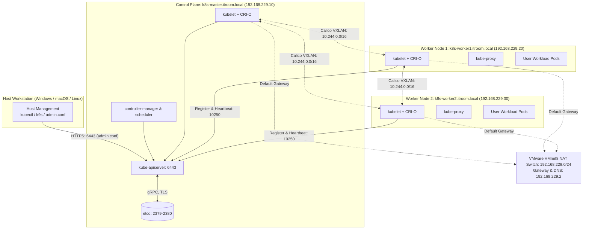

# Kubernetes: 3-Node Cluster on Rocky Linux (VMware Local Setup)

| | |
|---|---|
| **Cluster** | 04 Containers & IDP |
| **Role** | Anchor (Bare-Metal / Virtualized Node Deployment Guide) |
| **Category** | Local Multi-Node Virtualization |
| **Prerequisites** | VMware Workstation Pro / Player / ESXi / Fusion, Rocky Linux 9 Minimal ISO, 16 GB+ Host RAM |
| **Target version** | Kubernetes 1.37+ on Rocky Linux 9 (x86_64), CRI-O 1.37+ |
| **Capstone phase** | Phase 3 (Months 9-12) |
| **Official docs** | https://kubernetes.io/docs/setup/production-environment/tools/kubeadm/ |

> A production-aligned deployment guide for provisioning a persistent, high-fidelity 3-node Kubernetes cluster (1 control-plane node, 2 worker nodes) on Rocky Linux 9 running inside VMware using **CRI-O** as the container runtime. This guide addresses critical architectural and configuration aspects often omitted in basic tutorials: static network planning without CIDR conflicts, VMware cloning deduplication (`machine-id` and UUIDs), native systemd cgroup management in CRI-O, the modern `pkgs.k8s.io` and openSUSE Build Service repositories, declarative `kubeadm-config.yaml` bootstrapping, Calico CNI networking, dynamic local storage provisioning, and remote `kubectl` access from the host.

---

## 1. Architecture and Environment Planning

Unlike container-in-container abstractions (such as `kind` or `k3d`), running Kubernetes across dedicated virtual machines inside VMware gives you exact operational parity with physical bare-metal and on-premises enterprise data centers. Every node runs an independent Linux kernel, real network interfaces, dedicated systemd init subsystems, and isolated cgroup hierarchies.

### 1.1 The 3-Node Topology



### 1.2 Hardware and Resource Allocations

Allocate resources based on your host machine's capacity. A 16 GB host can comfortably run this 3-node cluster:

| Node Name | FQDN | Role | vCPU | RAM | Disk | Network Adapter | Static IP |
|---|---|---|---|---|---|---|---|
| `k8s-master` | `k8s-master.itroom.local` | Control Plane | 2 vCPU | 4 GB | 30 GB (Thin Provisioned) | NAT (VMnet8) | `192.168.229.10` |
| `k8s-worker1` | `k8s-worker1.itroom.local` | Worker Node | 2 vCPU | 3 GB (min 2 GB) | 30 GB (Thin Provisioned) | NAT (VMnet8) | `192.168.229.20` |
| `k8s-worker2` | `k8s-worker2.itroom.local` | Worker Node | 2 vCPU | 3 GB (min 2 GB) | 30 GB (Thin Provisioned) | NAT (VMnet8) | `192.168.229.30` |

> [!IMPORTANT]
> The Kubernetes API server and etcd require at least **2 full vCPUs** on the control-plane node. Initializing `kubeadm init` with only 1 vCPU will fail pre-flight validation checks unless bypassed with `--ignore-preflight-errors=NumCPU` (which causes severe etcd latency spikes and should never be used).

### 1.3 Subnet and CIDR Planning (Avoiding Overlap Disasters)

A frequent pitfall in bare-metal and VM installations is IP overlap between the host/node network, the Kubernetes Pod network, and the Service network:

| Network Scope | Subnet CIDR | Description |
|---|---|---|
| **VM Node Network** | `192.168.229.0/24` | VMware Virtual Network (NAT mode). Nodes (`.10`, `.20`, `.30`) and gateway (`.2`) live here. |
| **Pod Network (CIDR)** | `10.244.0.0/16` | Assigned to Pods across all nodes by Calico CNI. |
| **Service Network (CIDR)** | `10.96.0.0/12` | Virtual ClusterIP addresses assigned to Kubernetes Services. |

> [!WARNING]
> Many public tutorials default to Calico's `192.168.0.0/16` for Pod CIDR. When your VM node subnet is in the `192.168.x.x` range (such as `192.168.229.0/24`), using `192.168.0.0/16` for pods creates an overlapping supernet, dropping pod traffic or breaking routing. We explicitly configure Pod CIDR as `10.244.0.0/16` to guarantee clean network separation.

---

## 2. VMware Virtualization Configuration and Cloning Caveats

### 2.1 Virtual Network Choice: NAT vs Bridged

For a portable laptop setup, **VMware NAT (`VMnet8`)** is strongly recommended over Bridged:
- **Bridged Mode**: Binds directly to your physical host Wi-Fi/Ethernet adapter. Whenever your laptop connects to a different Wi-Fi network, your VMs may lose their DHCP leases, get different subnets, or lose network routing altogether.
- **NAT Mode (`VMnet8`)**: Creates an isolated virtual switch inside your host with an internal gateway (`192.168.229.2`). Your VMs retain stable, immutable static IPs whether your laptop is on office Wi-Fi, home Wi-Fi, or completely offline on an airplane.

Configure your VMware Virtual Network Editor:
1. Open **Virtual Network Editor** (in VMware Workstation: `Edit` -> `Virtual Network Editor`).
2. Select `VMnet8` (NAT).
3. Subnet IP: `192.168.229.0`, Subnet mask: `255.255.255.0`.
4. NAT Settings: Gateway IP set to `192.168.229.2`.

### 2.2 Installing the Base "Golden Image" VM

1. Create a new VM in VMware:
   - OS: Linux -> Rocky Linux 9 (or Red Hat Enterprise Linux 9 64-bit).
   - Compute: 2 vCPUs, 4 GB RAM, 30 GB disk (Store virtual disk as single file).
   - Network: Custom -> `VMnet8 (NAT)`.
2. Boot from the official **Rocky Linux 9 Minimal ISO** (`Rocky-9.x-x86_64-minimal.iso`).
3. In the installer:
   - Partitioning: Standard or LVM with `/` occupying the full disk. **Do not create a swap partition**, or delete it during manual partitioning.
   - Root password and administrative user: create user `rocky` with `wheel` (sudo) privileges.
   - Network & Hostname: Enable the interface and set temporary hostname `rocky-base`.
4. Complete installation and reboot.

### 2.3 Critical Cloning Traps (Deduplication)

Cloning a configured VM template saves hours, but if done incorrectly in VMware, it will silently corrupt a Kubernetes cluster because kubelet and etcd rely on unique hardware signatures:

#### 1. Unique MAC Addresses
When cloning in VMware Workstation / Fusion:
- Right-click the base VM -> **Manage** -> **Clone** -> **Create a full clone**.
- After cloning, edit VM Settings -> Network Adapter -> Advanced -> Click **Generate** under MAC Address to ensure each VM has a distinct virtual MAC.

#### 2. Unique Machine ID (`/etc/machine-id`)
Systemd assigns a unique 128-bit ID on installation. Kubelet uses `/etc/machine-id` as the node's unique hardware identifier. If worker nodes share the same `machine-id`, kubelet will overwrite node records in `etcd`, causing workers to flap or vanish.

On each cloned node (`k8s-worker1` and `k8s-worker2`), regenerate the machine-id:

```bash
sudo rm -f /etc/machine-id /var/lib/dbus/machine-id
sudo systemd-machine-id-setup
sudo ln -sf /etc/machine-id /var/lib/dbus/machine-id
cat /etc/machine-id
```

#### 3. Unique System UUID
Check the hardware UUID assigned by VMware:

```bash
sudo cat /sys/class/dmi/id/product_uuid
```

Every node must output a different UUID. When VMware prompts on first boot: *"Did you move it or copy it?"*, **always select "I copied it"**; VMware will then generate a new BIOS UUID and MAC address.

---

## 3. Operating System Configuration (Execute on ALL 3 Nodes)

The steps in this section must be executed on `k8s-master`, `k8s-worker1`, and `k8s-worker2`.

### 3.1 Static IP and Hostname Setup

Set the specific hostname on each server:

```bash
# On Master:
sudo hostnamectl set-hostname k8s-master.itroom.local

# On Worker 1:
sudo hostnamectl set-hostname k8s-worker1.itroom.local

# On Worker 2:
sudo hostnamectl set-hostname k8s-worker2.itroom.local
```

Configure static networking using `nmcli`. Identify your interface name first via `ip link` (usually `ens33`, `ens160`, or `eth0`):

```bash
# Example for k8s-master (replace ens33 with your interface name):
sudo nmcli connection modify ens33 \
  ipv4.method manual \
  ipv4.addresses 192.168.229.10/24 \
  ipv4.gateway 192.168.229.2 \
  ipv4.dns "192.168.229.2,8.8.8.8" \
  connection.autoconnect yes

sudo nmcli connection up ens33
```

*(Repeat on `k8s-worker1` with `192.168.229.20/24` and `k8s-worker2` with `192.168.229.30/24`).*

Configure `/etc/hosts` identically on **all three nodes** to ensure reliable name resolution without depending on an external DNS server:

```bash
sudo tee -a /etc/hosts <<'EOF'
192.168.229.10 k8s-master.itroom.local k8s-master
192.168.229.20 k8s-worker1.itroom.local k8s-worker1
192.168.229.30 k8s-worker2.itroom.local k8s-worker2
EOF
```

Verify reachability:

```bash
ping -c 2 k8s-master
ping -c 2 k8s-worker1
ping -c 2 k8s-worker2
```

### 3.2 Time Synchronization and VMware Tools

Ensure VMware guest integration and synchronized clocks (etcd Raft consensus fails if clocks drift by more than a few hundred milliseconds):

```bash
sudo dnf install -y open-vm-tools chrony
sudo systemctl enable --now open-vm-tools
sudo systemctl enable --now chronyd
sudo chronyc tracking
```

### 3.3 Disable Linux Swap

Kubernetes memory management and Quality of Service (QoS) guarantees assume container memory limits are absolute. If the OS swaps memory pages out to disk, container performance predictability breaks and the kubelet eviction manager cannot accurately calculate node pressure.

```bash
# Disable swap immediately
sudo swapoff -a

# Disable swap persistently across reboots
sudo sed -i '/\sswap\s/ s/^#*/#/' /etc/fstab

# If zram-generator or a systemd swap target exists:
sudo systemctl mask dev-zram0.swap 2>/dev/null || true
```

Verify swap is 0:

```bash
free -m
```

The output for `Swap:` must report `0` for `total`, `used`, and `free`.

### 3.4 SELinux Configuration

In Rocky Linux and RHEL-based distributions, SELinux defaults to `Enforcing`. CRI-O was engineered at Red Hat and has native, first-class SELinux integration. However, to eliminate initial permission friction during local cluster setup and CNI deployment, set SELinux to `Permissive` (which logs policy notifications instead of blocking low-level syscalls):

```bash
# Set permissive mode immediately
sudo setenforce 0

# Make persistent across reboots
sudo sed -i 's/^SELINUX=enforcing/SELINUX=permissive/' /etc/selinux/config

# Install container policy packages
sudo dnf install -y container-selinux
```

Verify SELinux status:

```bash
getenforce
# Output must be: Permissive
```

### 3.5 Kernel Modules and Sysctl Tuning

CRI-O and the Kubernetes CNI require Linux bridge netfilter and packet forwarding enabled in the kernel:

```bash
# Create the modules configuration
sudo tee /etc/modules-load.d/k8s.conf <<'EOF'
overlay
br_netfilter
EOF

# Load modules immediately
sudo modprobe overlay
sudo modprobe br_netfilter

# Configure sysctl networking parameters
sudo tee /etc/sysctl.d/99-kubernetes-cri.conf <<'EOF'
net.bridge.bridge-nf-call-iptables  = 1
net.bridge.bridge-nf-call-ip6tables = 1
net.ipv4.ip_forward                 = 1
EOF

# Apply sysctl settings without reboot
sudo sysctl --system
```

**Why this configuration is required:**
- `overlay`: Enables the OverlayFS storage driver used by CRI-O to manage container images and container write layers.
- `br_netfilter`: Ensures packets traversing virtual bridges (such as `cbr0` or CNI interfaces) are processed by host `iptables` and `nftables` chains.
- `net.ipv4.ip_forward = 1`: Permits the Linux kernel to route packets between different interfaces (allowing traffic to flow between physical interfaces and container virtual ethernet pairs).

### 3.6 Firewall (`firewalld`) Strategy

Rocky Linux enables `firewalld` by default. You have two valid architectural choices:

#### Option A: Production-Grade Hardening (Keep firewalld Enabled)
Open only the official Kubernetes and CNI communication ports:

**On `k8s-master` (Control Plane):**
```bash
sudo firewall-cmd --permanent --add-port=6443/tcp        # Kubernetes API Server
sudo firewall-cmd --permanent --add-port=2379-2380/tcp   # etcd server client API
sudo firewall-cmd --permanent --add-port=10250/tcp       # Kubelet API
sudo firewall-cmd --permanent --add-port=10257/tcp       # kube-controller-manager
sudo firewall-cmd --permanent --add-port=10259/tcp       # kube-scheduler
# CNI Calico Overlay ports:
sudo firewall-cmd --permanent --add-port=179/tcp         # Calico BGP
sudo firewall-cmd --permanent --add-port=4789/udp        # Calico VXLAN
sudo firewall-cmd --permanent --add-masquerade
sudo firewall-cmd --reload
```

**On Worker Nodes (`k8s-worker1` and `k8s-worker2`):**
```bash
sudo firewall-cmd --permanent --add-port=10250/tcp       # Kubelet API
sudo firewall-cmd --permanent --add-port=30000-32767/tcp # NodePort Services
# CNI Calico Overlay ports:
sudo firewall-cmd --permanent --add-port=179/tcp         # Calico BGP
sudo firewall-cmd --permanent --add-port=4789/udp        # Calico VXLAN
sudo firewall-cmd --permanent --add-masquerade
sudo firewall-cmd --reload
```

#### Option B: Lab Isolation (Disable firewalld)
If the cluster is strictly confined to a private VMware NAT network (`VMnet8`) with no external ingress routes, disabling `firewalld` completely eliminates potential nftables/iptables race conditions with CNI plugins:

```bash
sudo systemctl disable --now firewalld
```

---

## 4. Container Runtime Installation (CRI-O)

**CRI-O** is an OCI-compliant Container Runtime Interface (CRI) implementation designed from the ground up specifically for Kubernetes. Unlike containerd (which is a general-purpose container engine used by Docker and multiple orchestrators), CRI-O has zero external orchestration baggage: it only runs Kubernetes Pods and is synchronized 1:1 with Kubernetes major/minor versions.

### 4.1 Why CRI-O on Rocky Linux?

- **Kubernetes-native cgroups**: CRI-O defaults to `systemd` cgroup management out of the box on systemd-based distributions like Rocky Linux, avoiding the cgroupfs mismatch issues common with containerd.
- **Enterprise Red Hat lineage**: CRI-O is the native container engine of Red Hat OpenShift, making it battle-tested on RHEL kernels.
- **Version Alignment**: CRI-O release numbers match Kubernetes release numbers (`v1.37` CRI-O runs `v1.37` Kubernetes).
- **Lightweight socket footprint**: CRI-O exposes a direct gRPC CRI endpoint at `/var/run/crio/crio.sock`.

### 4.2 Configure the CRI-O RPM Repository (v1.37 - Latest Stable)

Upstream CRI-O publishes verified RPM builds for Enterprise Linux 9 via the openSUSE Build Service (`isv:cri-o`). Run on **all 3 nodes**:

```bash
CRIO_VERSION="v1.37"

sudo tee /etc/yum.repos.d/cri-o.repo <<EOF
[cri-o]
name=CRI-O
baseurl=https://download.opensuse.org/repositories/isv:/cri-o:/stable:/$CRIO_VERSION/rpm/
enabled=1
gpgcheck=1
gpgkey=https://download.opensuse.org/repositories/isv:/cri-o:/stable:/$CRIO_VERSION/rpm/repodata/repomd.xml.key
EOF
```

### 4.3 Install CRI-O and Dependencies

Install `container-selinux` and `cri-o` on **all 3 nodes**:

```bash
sudo dnf install -y container-selinux
sudo dnf install -y cri-o
```

> [!NOTE]
> `cri-o` is the container runtime daemon itself and installs directly from the CRI-O repository. The companion CLI debugging tool `cri-tools` (which provides `crictl`) is maintained by the Kubernetes project and hosted in the `pkgs.k8s.io` repository. It is installed in **Step 5.2** alongside `kubelet` and `kubeadm` using `--disableexcludes=kubernetes`, or you can download the static `crictl` binary directly in Step 4.5 below.

### 4.4 Configure CRI-O Systemd Cgroup and Pause Image

CRI-O supports modular drop-in configurations under `/etc/crio/crio.conf.d/`. Create a drop-in file to explicitly lock in the `systemd` cgroup manager and pin the pause container image to `registry.k8s.io/pause:3.10`:

```bash
sudo mkdir -p /etc/crio/crio.conf.d

sudo tee /etc/crio/crio.conf.d/02-cgroup-manager.conf <<'EOF'
[crio.runtime]
cgroup_manager = "systemd"
conmon_cgroup = "pod"

[crio.image]
pause_image = "registry.k8s.io/pause:3.10"
EOF
```

Configure `crictl` so CLI debugging commands (`crictl ps`, `crictl pods`, `crictl images`) automatically connect to the CRI-O socket without requiring manual flag specifications:

```bash
sudo tee /etc/crictl.yaml <<'EOF'
runtime-endpoint: unix:///var/run/crio/crio.sock
image-endpoint: unix:///var/run/crio/crio.sock
timeout: 10
debug: false
EOF
```

### 4.5 Start and Enable CRI-O

Reload systemd daemon, start CRI-O, and ensure it launches on boot:

```bash
sudo systemctl daemon-reload
sudo systemctl enable --now crio
sudo systemctl status crio --no-pager
```

Verify the CRI-O runtime socket is active:

```bash
sudo test -S /var/run/crio/crio.sock && echo "CRI-O socket is active and listening"
```

*(Optional)* If you wish to use the `crictl` CLI before installing Kubernetes packages in Step 5, you can install the standalone `crictl` binary directly from GitHub releases:

```bash
CRICTL_VERSION="v1.32.0"
curl -fsSL "https://github.com/kubernetes-sigs/cri-tools/releases/download/${CRICTL_VERSION}/crictl-${CRICTL_VERSION}-linux-amd64.tar.gz" | sudo tar -C /usr/local/bin -xz
crictl --version
```

Expected output:
```text
crictl version 1.32.0
```

---

## 5. Kubernetes Package Installation (`pkgs.k8s.io`)

> [!IMPORTANT]
> The legacy Google-hosted repositories (`packages.cloud.google.com` / `apt.kubernetes.io` / `yum.kubernetes.io`) were permanently deprecated and decommissioned in 2024. All modern Kubernetes packages are published exclusively on the community-owned infrastructure at **`pkgs.k8s.io`**.

### 5.1 Configure the Kubernetes RPM Repository (v1.37 - Latest Stable)

Run on **all 3 nodes**:

```bash
KUBERNETES_VERSION="v1.37"

sudo tee /etc/yum.repos.d/kubernetes.repo <<EOF
[kubernetes]
name=Kubernetes
baseurl=https://pkgs.k8s.io/core:/stable:/$KUBERNETES_VERSION/rpm/
enabled=1
gpgcheck=1
gpgkey=https://pkgs.k8s.io/core:/stable:/$KUBERNETES_VERSION/rpm/repodata/repomd.xml.key
exclude=kubelet kubeadm kubectl cri-tools kubernetes-cni
EOF
```

### 5.2 Install kubeadm, kubelet, kubectl, and cri-tools

Install the pinned packages and `cri-tools` from the `pkgs.k8s.io` repository:

```bash
sudo dnf install -y kubelet kubeadm kubectl cri-tools --disableexcludes=kubernetes

# Enable the kubelet daemon
sudo systemctl enable --now kubelet
```

> [!NOTE]
> If you run `systemctl status kubelet` right now, it will show as crashlooping or waiting:
> `kubelet.service: Main process exited, code=exited, status=1/FAILURE`
> **This is completely normal.** The kubelet is waiting for `kubeadm` to create the initial TLS certificates and `/etc/kubernetes/kubelet.conf`. It will automatically stabilize once the cluster is initialized or joined.

---

## 6. Control Plane Bootstrapping (`k8s-master` Only)

Execute the steps in this section **only** on `k8s-master` (`192.168.229.10`).

### 6.1 Pre-pull Container Images

Pre-pull the control-plane container images using CRI-O to verify network connectivity and avoid timeout failures during initialization:

```bash
sudo kubeadm config images pull --cri-socket unix:///var/run/crio/crio.sock
```

### 6.2 Declarative Cluster Initialization (`kubeadm-config.yaml`)

Rather than relying on opaque CLI arguments (`kubeadm init --pod-network-cidr=...`), define your cluster declaratively using a configuration manifest. Explicitly specify the CRI-O runtime socket path (`unix:///var/run/crio/crio.sock`) and Subject Alternative Names (SANs) so you can communicate with the API server from your Windows/macOS host machine without TLS certificate errors:

```bash
cat <<'EOF' > kubeadm-config.yaml
apiVersion: kubeadm.k8s.io/v1beta4
kind: InitConfiguration
localAPIEndpoint:
  advertiseAddress: 192.168.229.10
  bindPort: 6443
nodeRegistration:
  criSocket: unix:///var/run/crio/crio.sock
  name: k8s-master.itroom.local
  taints:
  - effect: NoSchedule
    key: node-role.kubernetes.io/control-plane
---
apiVersion: kubeadm.k8s.io/v1beta4
kind: ClusterConfiguration
kubernetesVersion: v1.37.0
clusterName: local-rocky-k8s
controlPlaneEndpoint: "192.168.229.10:6443"
networking:
  podSubnet: "10.244.0.0/16"
  serviceSubnet: "10.96.0.0/12"
  dnsDomain: "cluster.local"
apiServer:
  certSANs:
  - "192.168.229.10"
  - "k8s-master"
  - "k8s-master.itroom.local"
  - "127.0.0.1"
  - "localhost"
---
apiVersion: kubelet.config.k8s.io/v1beta1
kind: KubeletConfiguration
cgroupDriver: systemd
EOF
```

Bootstrap the control plane:

```bash
sudo kubeadm init --config kubeadm-config.yaml
```

### 6.3 Post-Init Setup: Configure User kubeconfig

Upon successful initialization, `kubeadm` prints:
`Your Kubernetes control-plane has initialized successfully!`

Configure administrative access for your regular `rocky` user account:

```bash
mkdir -p $HOME/.kube
sudo cp -i /etc/kubernetes/admin.conf $HOME/.kube/config
sudo chown $(id -u):$(id -g) $HOME/.kube/config
chmod 600 $HOME/.kube/config
```

Verify initial API server communication:

```bash
kubectl cluster-info
kubectl get nodes
```

The master node will report status **`NotReady`**. This is expected: the node cannot become `Ready` until a Container Network Interface (CNI) plugin is installed to manage pod routing.

---

## 7. Pod Network (CNI) Installation (Calico)

A CNI plugin is required so Pods can communicate across physical nodes and CoreDNS can allocate virtual IPs. We deploy **Project Calico** using its standard production manifest.

### 7.1 Deploy Calico

Download and configure Calico to match our specified Pod CIDR (`10.244.0.0/16`):

```bash
curl -fsSL https://raw.githubusercontent.com/projectcalico/calico/v3.33.0/manifests/calico.yaml -o calico.yaml

# Replace default 192.168.0.0/16 CIDR with our 10.244.0.0/16 CIDR
sed -i 's|# - name: CALICO_IPV4POOL_CIDR|- name: CALICO_IPV4POOL_CIDR|g' calico.yaml
sed -i 's|#   value: "192.168.0.0/16"|  value: "10.244.0.0/16"|g' calico.yaml

# Apply the manifest
kubectl apply -f calico.yaml
```

### 7.2 Verify CoreDNS and Master Readiness

Watch the control-plane components stabilize:

```bash
kubectl get pods -n kube-system -w
```

Within 60 to 90 seconds:
1. `calico-node` and `calico-kube-controllers` transition to `Running`.
2. `coredns` pods transition from `Pending` to `Running`.
3. The control-plane node transitions to `Ready`:

```bash
kubectl get nodes
# Expected output:
# NAME                      STATUS   ROLES           AGE   VERSION
# k8s-master.itroom.local   Ready    control-plane   2m    v1.37.x
```

---

## 8. Worker Node Joining (`k8s-worker1` and `k8s-worker2`)

### 8.1 Extract the Join Command

The `kubeadm init` output on `k8s-master` provided a join command with an authentication token and CA certificate hash. If you need to retrieve or generate a fresh token at any time, run this on `k8s-master`:

```bash
kubeadm token create --print-join-command
```

The output looks like:

```bash
sudo kubeadm join 192.168.229.10:6443 --token <TOKEN_VALUE> \
    --discovery-token-ca-cert-hash sha256:<HASH_VALUE>
```

### 8.2 Execute Join on Worker Nodes

Log in to **`k8s-worker1`** and run the join command with `sudo` (specifying the CRI-O socket):

```bash
sudo kubeadm join 192.168.229.10:6443 --token <TOKEN_VALUE> \
    --discovery-token-ca-cert-hash sha256:<HASH_VALUE> \
    --cri-socket unix:///var/run/crio/crio.sock
```

Log in to **`k8s-worker2`** and run the same join command:

```bash
sudo kubeadm join 192.168.229.10:6443 --token <TOKEN_VALUE> \
    --discovery-token-ca-cert-hash sha256:<HASH_VALUE> \
    --cri-socket unix:///var/run/crio/crio.sock
```

### 8.3 Verify Cluster Membership on Master

Return to `k8s-master` and check node status:

```bash
kubectl get nodes -o wide
```

Expected output:

```text
NAME                       STATUS   ROLES           AGE     VERSION   INTERNAL-IP      EXTERNAL-IP   OS-IMAGE                      KERNEL-VERSION                         CONTAINER-RUNTIME
k8s-master.itroom.local    Ready    control-plane   3h44m   v1.37.2   192.168.229.10   <none>        Rocky Linux 9.8 (Blue Onyx)   5.14.0-687.66.1.el9_8.x86_64 (amd64)   cri-o://1.37.3
k8s-worker1.itroom.local   Ready    worker          3h29m   v1.37.2   192.168.229.20   <none>        Rocky Linux 9.8 (Blue Onyx)   5.14.0-687.66.1.el9_8.x86_64 (amd64)   cri-o://1.37.3
k8s-worker2.itroom.local   Ready    worker          3h29m   v1.37.2   192.168.229.30   <none>        Rocky Linux 9.8 (Blue Onyx)   5.14.0-687.66.1.el9_8.x86_64 (amd64)   cri-o://1.37.3
```

Label the worker nodes so their roles display cleanly in `kubectl`:

```bash
kubectl label node k8s-worker1.itroom.local node-role.kubernetes.io/worker=worker
kubectl label node k8s-worker2.itroom.local node-role.kubernetes.io/worker=worker
```

---

## 9. Essential Add-ons for Local Workloads

A bare `kubeadm` cluster lacks dynamic volume provisioning and resource metrics out-of-the-box. Without these two add-ons, stateful workloads (like PostgreSQL) will fail to bind PVCs, and autoscaling (`HPA`) and `kubectl top` will not function.

### 9.1 Dynamic Local Storage (`local-path-provisioner`)

Install Rancher's lightweight `local-path-provisioner`, which dynamically allocates host directories on worker nodes to fulfill `PersistentVolumeClaims`:

```bash
kubectl apply -f https://raw.githubusercontent.com/rancher/local-path-provisioner/v0.0.37/deploy/local-path-storage.yaml

# Set local-path as the default StorageClass
kubectl patch storageclass local-path -p '{"metadata": {"annotations":{"storageclass.kubernetes.io/is-default-class":"true"}}}'
```

Verify the storage class:

```bash
kubectl get storageclass
# Expected output:
# NAME                   PROVISIONER             RECLAIMPOLICY   VOLUMEBINDINGMODE      ALLOWVOLUMEEXPANSION   AGE
# local-path (default)   rancher.io/local-path   Delete          WaitForFirstConsumer   false                  10s
```

### 9.2 Metrics Server (Resource Monitoring & HPA)

Deploy `metrics-server`. Because local lab clusters use self-signed certificates for kubelet serving endpoints, patch the deployment with `--kubelet-insecure-tls`:

```bash
kubectl apply -f https://github.com/kubernetes-sigs/metrics-server/releases/latest/download/components.yaml

# Patch metrics-server to allow self-signed kubelet certs
kubectl patch deployment metrics-server -n kube-system --type='json' -p='[
  {"op": "add", "path": "/spec/template/spec/containers/0/args/-", "value": "--kubelet-insecure-tls"}
]'
```

Verify metrics are reporting (wait ~60 seconds for collection cycle):

```bash
kubectl top nodes
kubectl top pods -n kube-system
```

---

## 10. Remote Management: Accessing Cluster from Host Machine

Instead of SSH-ing into `k8s-master` to run `kubectl`, configure your host workstation (Windows 11 PowerShell or macOS Terminal) to control the cluster directly.

### 10.1 Copy `admin.conf` to Host

From your host terminal (PowerShell or Bash), copy the kubeconfig from `k8s-master`:

```powershell
# Windows PowerShell:
mkdir $HOME\.kube -Force
scp rocky@192.168.229.10:~/.kube/config $HOME\.kube\config-rocky

# Set KUBECONFIG or merge with existing configuration:
$env:KUBECONFIG="$HOME\.kube\config-rocky"
kubectl get nodes
```

Because we configured `certSANs` with `192.168.229.10` in `kubeadm-config.yaml`, the host's `kubectl` client validates the API server TLS certificate without errors.

---

## 11. End-to-End Cluster Smoke Test

Verify cross-node networking, service routing, pod-to-pod connectivity, and DNS resolution.

### 11.1 Deploy a Multi-Replica Smoke Test Application

Create a test namespace and a deployment with 4 replicas to ensure pods are scheduled across both worker nodes:

```bash
cat <<'EOF' | kubectl apply -f -
apiVersion: v1
kind: Namespace
metadata:
  name: smoke-test
---
apiVersion: apps/v1
kind: Deployment
metadata:
  name: web-test
  namespace: smoke-test
spec:
  replicas: 4
  selector:
    matchLabels:
      app: web-test
  template:
    metadata:
      labels:
        app: web-test
    spec:
      containers:
      - name: nginx
        image: nginx:alpine
        ports:
        - containerPort: 80
---
apiVersion: v1
kind: Service
metadata:
  name: web-service
  namespace: smoke-test
spec:
  type: NodePort
  selector:
    app: web-test
  ports:
  - port: 80
    targetPort: 80
    nodePort: 30080
EOF
```

### 11.2 Verify Placement and DNS

Check that pods are distributed across `k8s-worker1` and `k8s-worker2`:

```bash
kubectl get pods -n smoke-test -o wide
```

Inspect the container runtime directly on worker nodes with `crictl`:

```bash
sudo crictl ps
```

Test cluster DNS resolution and service routing from an ephemeral debug pod:

```bash
kubectl run curl-test --rm -it --restart=Never -n smoke-test --image=curlimages/curl -- \
  curl -s http://web-service.smoke-test.svc.cluster.local
```

You should receive the default `"Welcome to nginx!"` HTML page.

Test external NodePort accessibility from your host machine or master:

```bash
curl -I http://192.168.229.20:30080
curl -I http://192.168.229.30:30080
```

Both worker node IPs will respond with `HTTP/1.1 200 OK`.

Clean up the test:

```bash
kubectl delete namespace smoke-test
```

---

## 12. Troubleshooting Guide: Rocky Linux, CRI-O, and VMware Specifics

| Symptom | Probable Cause | Diagnostic Command | Immediate Fix |
|---|---|---|---|
| **`cri-tools package is not available` / `No match for argument: cri-tools`** | Attempted to install `cri-tools` before configuring `kubernetes.repo`, or without `--disableexcludes=kubernetes`. `cri-tools` is in `pkgs.k8s.io`, not the CRI-O OBS repo. | `sudo dnf info cri-tools` | Install `cri-tools` after adding `kubernetes.repo` using `sudo dnf install -y cri-tools --disableexcludes=kubernetes`, or install the standalone binary directly via GitHub. |
| **`crio` service fails to start** | Duplicate storage configuration, missing kernel modules, or invalid `/etc/crio/crio.conf.d/` syntax. | `sudo journalctl -xeu crio -n 50` | Verify `overlay` and `br_netfilter` are loaded (`lsmod \| grep overlay`). Test syntax with `sudo crio config`. |
| **`crictl` cannot connect to runtime endpoint** | Default endpoint misconfigured or CRI-O socket not created. | `sudo crictl info` | Verify `/etc/crictl.yaml` points to `unix:///var/run/crio/crio.sock` and `sudo systemctl status crio` is active. |
| **Worker node vanishes or overwrites master/other worker** | Cloned VMs share duplicate `/etc/machine-id` or duplicate MAC addresses. | `sudo cat /etc/machine-id` on all nodes; compare values. | Run `sudo rm -f /etc/machine-id && sudo systemd-machine-id-setup`. Reboot worker node and rejoin. |
| **`kubelet` service fails to start immediately after install** | Normal before `kubeadm init` runs. If failing *after* init, swap is enabled or CRI socket path mismatch. | `sudo journalctl -xeu kubelet -n 50` | Ensure `free -m` shows 0 swap. Verify kubelet configuration references `unix:///var/run/crio/crio.sock`. |
| **`kubeadm init` fails: `[ERROR NumCPU]: the number of available CPUs 1 is less than 2`** | VMware VM was created with only 1 vCPU. | `lscpu \| grep "CPU(s):"` | Power off VM in VMware, edit VM settings, increase CPU cores to at least 2 vCPUs. |
| **CoreDNS pods stuck in `Pending`** | CNI plugin (Calico) is not installed or has not reached `Ready`. | `kubectl get pods -n kube-system` | Apply Calico manifest (`kubectl apply -f calico.yaml`). Check `kubectl describe pod coredns-... -n kube-system`. |
| **CoreDNS pods stuck in `CrashLoopBackOff`** | DNS loop detected or `net.bridge.bridge-nf-call-iptables` is disabled. | `kubectl logs -n kube-system -l k8s-app=kube-dns` | Run `sudo sysctl net.bridge.bridge-nf-call-iptables=1` and `sudo sysctl --system`. Check `/etc/resolv.conf` for 127.0.0.53 loops. |
| **`kubeadm join` times out or connection refused** | `firewalld` on `k8s-master` is blocking port 6443, or wrong master IP specified. | `nc -zvw3 192.168.229.10 6443` or `curl -k https://192.168.229.10:6443` | On master: `sudo firewall-cmd --permanent --add-port=6443/tcp && sudo firewall-cmd --reload` (or stop firewalld). |
| **Pods on worker nodes cannot reach pods on other nodes** | VMware virtual network dropping promiscuous/forged traffic, or VXLAN port 4789/udp blocked. | Run `calicoctl node status` or ping pod IP directly from worker. | Open port 4789/udp in firewalld on all nodes. Ensure `net.ipv4.ip_forward = 1` is enabled on all hosts. |
| **Join token expired (`token has expired`)** | Tokens generated by `kubeadm` expire after 24 hours. | `kubeadm token list` on master. | On master: `kubeadm token create --print-join-command` and execute the new command on worker. |

---

## 13. Comparison: VMware Local Setup (CRI-O) vs kind vs Cloud Managed (EKS)

| Dimension | VMware 3-Node (Rocky Linux + CRI-O) | kind (Kubernetes-in-Docker) | Amazon EKS (Cloud Managed) |
|---|---|---|---|
| **Architecture** | Real multi-VM / bare-metal emulation | Containerized nodes sharing host kernel | AWS-managed control plane, EC2 worker nodes |
| **Container Runtime** | **CRI-O** (dedicated Kubernetes runtime) | containerd | containerd (AL2023 / Bottlerocket) |
| **OS & Init Subsystem** | Full systemd, distinct kernels, real cgroups | Fake systemd inside Docker container | Real Linux nodes (AL2023 / Ubuntu / Bottlerocket) |
| **Networking Fidelity** | Real L2/L3 overlay (Calico VXLAN), real `firewalld` | Docker bridge + veth pairs; kindnet/Cilium | AWS VPC CNI (native VPC IP per pod) |
| **Resource Footprint** | ~10 GB RAM across 3 VMs (medium-high) | ~3-4 GB RAM total (low) | 0 GB local RAM (runs in AWS cloud) |
| **Setup & Teardown Time** | 20-30 minutes (retained long-term) | 3-4 minutes via Makefile (disposable) | 15-20 minutes via Terraform (costs $/hr) |
| **Storage Architecture** | Real local block/path (`local-path-provisioner`) | Emulated Docker volumes | AWS EBS CSI (`gp3`) / EFS CSI |
| **Best Used For** | Learning cluster operations, upgrades, OS hardening, CRI-O internals, CKA/CKS exam prep | Fast daily developer loops, CI/CD pipelines, lightweight local testing | Production enterprise deployments, autoscaling (Karpenter), cloud IAM (IRSA) |

---

## 14. Cluster Maintenance Quick Reference

### Snapshot the Cluster (VMware)
Before testing risky upgrades, etcd mutations, or kernel changes:
1. Power off all three VMs: `sudo shutdown -h now`.
2. In VMware Workstation / Fusion: Select each VM -> **Snapshot** -> **Take Snapshot** (e.g., `clean-k8s-v1.37-crio-installed`).
3. If an experiment breaks the control plane or etcd quorum, revert all 3 VMs to the snapshot in under 10 seconds.

### Drain and Cordon a Worker Node
When performing OS updates (`dnf update`) on a worker node:

```bash
# On Master: Mark node unschedulable and evict pods
kubectl drain k8s-worker1.itroom.local --ignore-daemonsets --delete-emptydir-data

# Perform maintenance on worker, reboot if needed...

# On Master: Uncordon node so pods can schedule again
kubectl uncordon k8s-worker1.itroom.local
```
